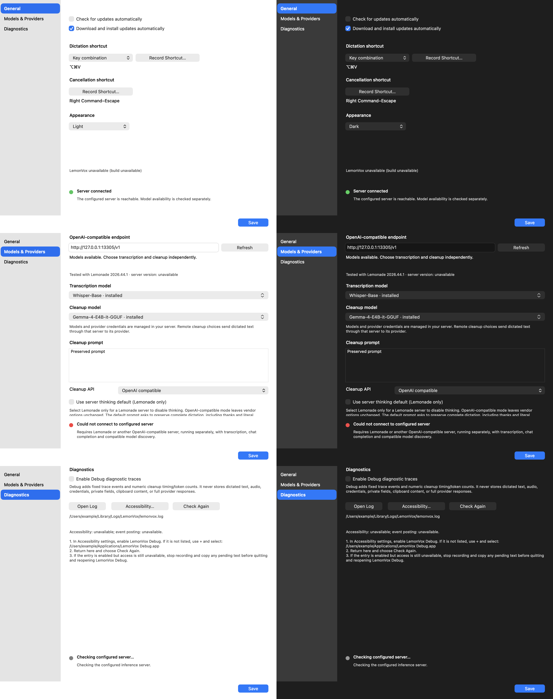
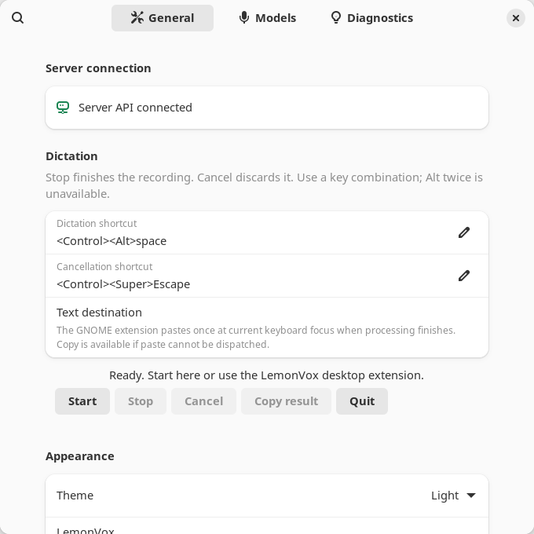
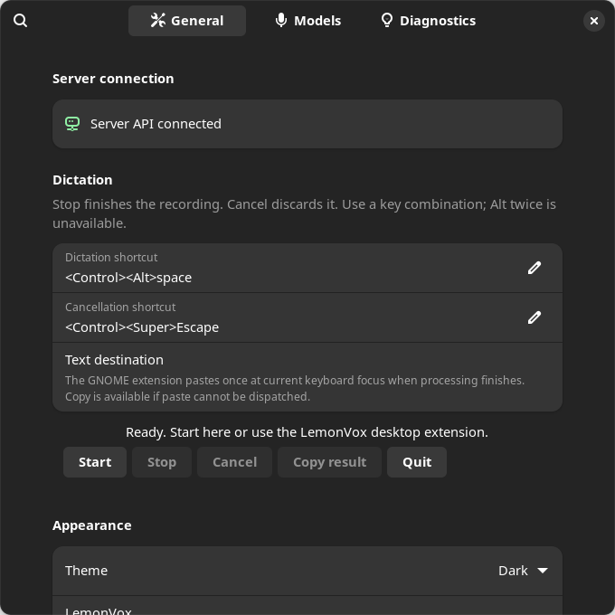
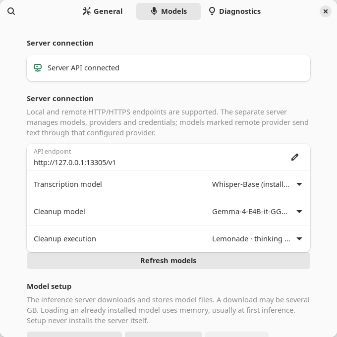
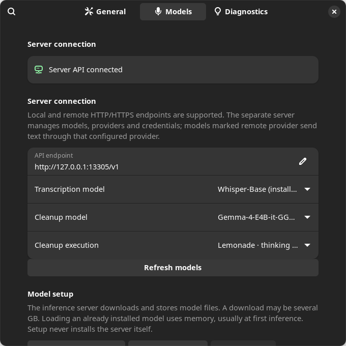
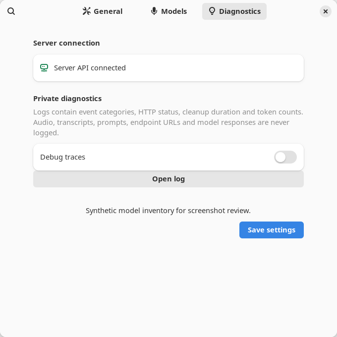
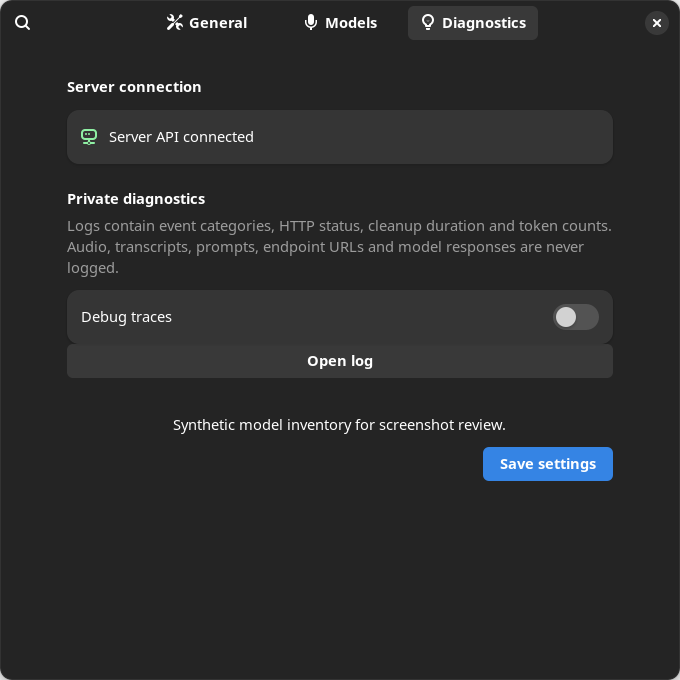
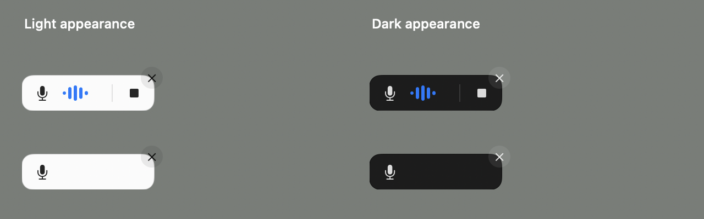
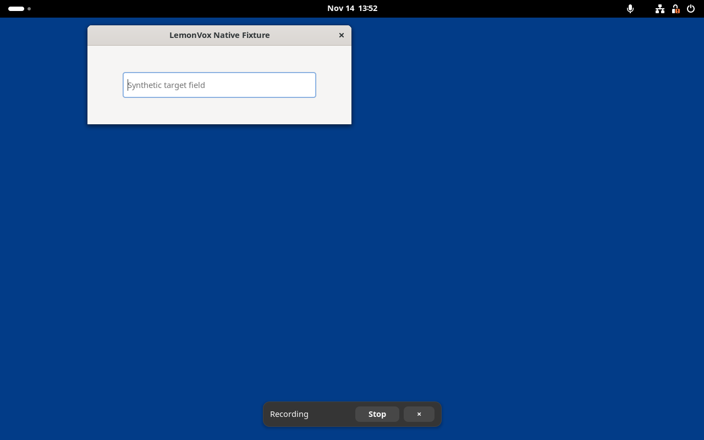
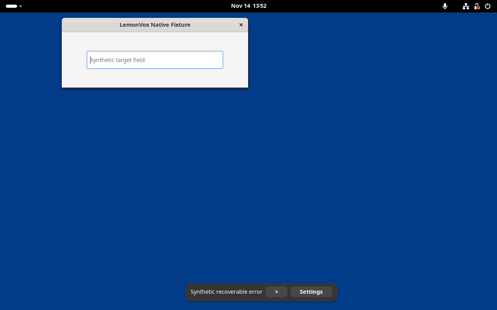

# Desktop design and native evidence

LemonVox uses one product vocabulary and interaction model with AppKit, Win32
and GNOME/Adwaita presentation. Native controls, typography, window chrome,
spacing, semantic colors and accessibility conventions remain platform-specific.
This comparison supports [#99](https://github.com/itomek/lemonvox/issues/99).

## Product contract

| Surface | Common meaning | Native differences to retain |
| --- | --- | --- |
| General | Dictation shortcut, cancellation shortcut, appearance, version/build and applicable updates | OS shortcut notation, permission recovery and update integration |
| Models & Providers | Server endpoint, connection status, transcription model, cleanup model and editable cleanup prompt | Native model pickers and discovery progress; explicit consent before installation |
| Advanced | Cleanup API/backend and supported thinking override, with the effective behavior explained | Unsupported vendor parameters remain absent for generic servers |
| Diagnostics | Content-free diagnostics, logging controls and recovery links | Platform log locations and permission interfaces |
| Recording bar | Finish stops capture and processes once; Cancel discards | Native nonactivating surfaces preserve the destination application's focus |
| Processing bar | Cancel remains available; Finish is unavailable | Native activity presentation and reduced-motion/transparency behavior |
| Settings persistence | Valid edits persist automatically; invalid drafts retain the last working value | Native inline validation and keyboard traversal |
| Setup/error surfaces | Distinguish unavailable from empty; preserve model selections; explain recovery | Native dialogs and desktop-specific capability limits |

The cleanup prompt stays readily accessible in Models & Providers. Advanced
contains execution overrides, not the everyday prompt editor. System-following
appearance has the same meaning even where a native control says **Auto**.

## Baseline gaps and dependency ownership

The baseline source is `020e0bf20d0deed1acc5044248b7fbb7ab6a79ac`.
These are observed source differences, not claims that native runtime testing
has passed. Capture fixtures below use production views with synthetic data;
they are neither mockups nor evidence of a released application running end to end.

| Area | macOS | Windows | Ubuntu GNOME | Owning work |
| --- | --- | --- | --- | --- |
| Persistence | Save closes Settings | Save/Cancel form | Save settings on each page | [#96](https://github.com/itomek/lemonvox/issues/96) |
| Navigation | General, Models & Providers, Diagnostics | One Settings form; Diagnostics from tray | General, Models, Diagnostics | #99; coordinate Windows General with [#53](https://github.com/itomek/lemonvox/issues/53) |
| Advanced cleanup | Execution controls in Models | Execution controls in main form | Execution controls in Models | [#97](https://github.com/itomek/lemonvox/issues/97), after #96 |
| Single-tap modifier | Double-tap/key combination choices | Double-tap/key combination choices | Accelerator chords; modifier-only rejected | [#98](https://github.com/itomek/lemonvox/issues/98), after #96 |
| Appearance | Auto/Light/Dark | Follows system; no explicit override | Auto/Light/Dark | #53 owns Windows override |
| Cancellation settings | Separate configurable control | Existing bar cancellation; modifier–Escape candidate is separate | Desktop accelerator setting | #53; [draft #61](https://github.com/itomek/lemonvox/pull/61) is not baseline behavior |
| Recording/processing | Finish and Cancel; processing hides Finish | Stop and X; processing retains X | Stop and Cancel; processing retains Cancel | #99 compares meaning and accessibility, not icon pixels |

Source anchors: [macOS Settings](../macos/ConfigDialog.swift),
[macOS shortcuts](../macos/TriggerControl.swift),
[macOS bar](../macos/IndicatorPanel.swift),
[Windows Settings](../windows/src/ui/settings_window.cpp),
[Windows layout](../windows/src/ui/settings_layout.cpp),
[Windows bar](../windows/src/ui/indicator.cpp),
[Ubuntu Settings](../ubuntu/settings.cpp) and
[GNOME bar](../ubuntu/extension/ui.js).

GNOME Wayland's current compositor accelerator integration does not deliver
standalone modifier events. Keep the working chord fallback until #98 supplies
native delivery evidence; do not present a nonfunctional single-tap choice.
See the [extension constraints](../ubuntu/extension/README.md).

## Native baseline images

Captured on November 14, 2026 from the baseline source plus the test-only
capture changes in this branch. No production settings or dictation behavior
changed. These images document existing gaps; they do not depict the planned
autosave, Advanced or single-tap changes.

| macOS: Light left, Dark right | Ubuntu: Light | Ubuntu: Dark |
| --- | --- | --- |
|  |  |  |
| [Models scrolled to setup controls](assets/desktop/macos-settings-model-bottom-light-dark.png) |  |  |
| [Minimum-height Settings sheet](assets/desktop/macos-settings-minimum-light-dark.png) |  |  |

macOS bar: recording above processing, Light left and Dark right. Offscreen
rendering does not demonstrate the animated processing spinner.



Ubuntu bar: the actual GNOME extension on a private Wayland desktop, driven by
a synthetic D-Bus service with a disposable target field. The desktop's system
theme controls the bar; these captures do not prove a Light/Dark transition.

| Recording | Processing | Recoverable error |
| --- | --- | --- |
|  |  |  |

### Capture environment and limits

| Platform | Environment | Capture | Version/build and scale |
| --- | --- | --- | --- |
| macOS | macOS 27.2.1, build 26B131; Apple Swift 6.4.2; arm64 target macOS 26 | AppKit production views, synthetic callbacks; offscreen content without window chrome | Unbundled test executable: app version/build unavailable. 2× offscreen raster; actual display scale unverified. Settings cells 820×690 logical points, minimum 820×480; bar sheet 640×200 logical points |
| Ubuntu | Ubuntu 24.04.5; GNOME Shell 46.0; GTK 4.14.5; libadwaita 1.5.0 | GTK Settings fixture under Xvfb; separate private GNOME Wayland extension fixture | CMake default version 0.2.0, not a release bundle. Settings 680×680 at GDK_SCALE=1; private Shell 1280×800 at scale 1. Other display scales unverified |
| Windows | Windows 11 Enterprise 10.0.26300, build 26300, x64; MSVC 19.44.35229, SDK 10.0.26100 | Capture tool built; no unlocked interactive desktop available in the SSH process session | **No screenshot captured.** App version, theme, display scale and runtime layout remain unverified |

Windows currently has one combined Settings form. Until that changes, capture
and label it as such instead of inventing separate General/Models views.
The native capture tool returns exit code 77 when its session has no unlocked
interactive Default desktop. No login, unlock or desktop configuration changes
are part of capture.

[Ubuntu capture metadata](assets/desktop/ubuntu-capture.json) records exact
commands and limitations. Its connected status and installed models are
synthetic. The initial Models viewport truncates model names with native
ellipsization and scrolls to lower controls; full-content visibility and
accessibility still need review.

### Reproduce captures

Run from the repository root. Use a fresh absolute build directory and an
existing output directory. Synthetic test executables do not qualify a shipped
app version. Review every PNG before committing it.

macOS:

```sh
bash scripts/build-debug-macos.sh --output /absolute/new/macos-build
/absolute/new/macos-build/settings-ui-test --render --render-output=/absolute/output/macos-settings-light-dark.png
/absolute/new/macos-build/settings-ui-test --render --render-minimum --render-output=/absolute/output/macos-settings-minimum-light-dark.png
/absolute/new/macos-build/settings-ui-test --render --render-model-bottom --render-output=/absolute/output/macos-settings-model-bottom-light-dark.png
/absolute/new/macos-build/overlay-test --render-only --render-output=/absolute/output/macos-bar-light-dark.png
```

Ubuntu (native dependencies in [development setup](../ubuntu/DEVELOPMENT.md)):

```sh
cmake -S ubuntu -B /absolute/new/ubuntu-build -DCMAKE_BUILD_TYPE=Debug
cmake --build /absolute/new/ubuntu-build --parallel
ctest --test-dir /absolute/new/ubuntu-build --output-on-failure
# Repeat for light/dark and General/Models/Diagnostics.
GDK_SCALE=1 GSK_RENDERER=cairo xvfb-run -a dbus-run-session -- \
  /absolute/new/ubuntu-build/lemonvox_settings_ui_test /absolute/output/ubuntu-general-light.png light General connected
LEMONVOX_TEST_PALETTE='' LEMONVOX_EVIDENCE_DIR=/absolute/output LIBGL_ALWAYS_SOFTWARE=1 \
  bash ubuntu/tests/extension_native_shell_test.sh
```

The extension harness uses an isolated compositor and disposable configuration,
not the logged-in desktop. Requested evidence now fails the harness if a
screenshot cannot be saved. See [native test requirements](../ubuntu/DEVELOPMENT.md).
The empty palette override disables the backend fixture's artificial color
palette so the production extension falls back to native GNOME colors.
For the documentation filenames, copy `gnome-shell-recording.png`,
`gnome-shell-processing.png` and `gnome-shell-error.png` to
`ubuntu-recording-system.png`, `ubuntu-processing-system.png` and
`ubuntu-error-system.png`, respectively.

Windows (run in an unlocked desktop session, not an SSH service session):

```powershell
powershell -NoProfile -ExecutionPolicy Bypass -File windows\scripts\build.ps1 -Output C:\absolute\new\windows-build
C:\absolute\new\windows-build\src\ui\screenshot_capture.exe C:\absolute\output
```

Expected outputs are `windows-settings.png`, `windows-recording.png` and
`windows-processing.png`. Use synthetic controls only; the tool refuses
unavailable desktop capture instead of generating placeholder images.

## Completion checks

After the dependent behavior changes land, refresh the same native views from
one candidate revision and review all three platforms together. A screenshot
baseline alone does not establish parity or close #99.

- Capture comparable General, Models & Providers, recording and processing
  surfaces; include Advanced, Diagnostics, setup consent and representative
  errors in the review. Label any unavailable category honestly.
- Record OS/desktop version, candidate commit, application version/build,
  appearance, logical window size, display scale and capture method. Never
  infer display scaling from PNG dimensions.
- Exercise Light, Dark and System, including a system appearance change while
  open. Check practical minimum sizes and supported display scales for clipping
  and overlaps, including long endpoint/model names and error text.
- Exercise keyboard traversal, visible focus, accessible names, contrast,
  reduced motion/transparency and nonactivating bar behavior on each desktop.
- Verify Finish, repeated trigger and Cancel through synthetic sessions,
  including cancellation during processing and suppression of late results.
- Verify automatic persistence, invalid drafts, failed writes/rebinding,
  rapid edit-and-close, relaunch and uninterrupted active dictation.
- Retain synthetic content only. Do not capture personal endpoints, dictated
  text, credentials or unrelated desktop windows.

Native interaction, screen-reader, scaling and released-app evidence must be
reported separately from native fixture rendering. Missing evidence is an open
verification item, not a pass.
