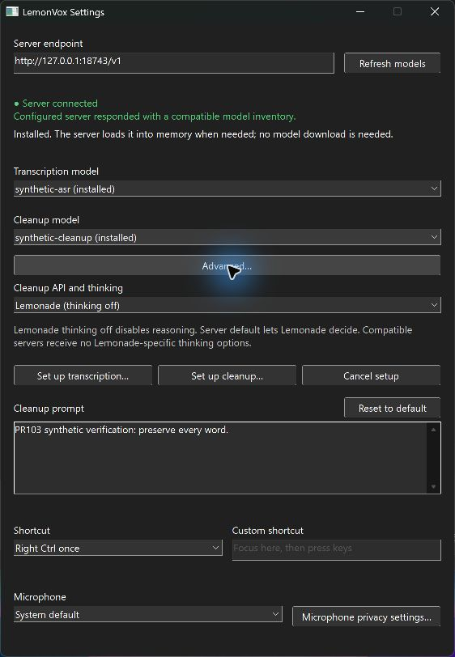
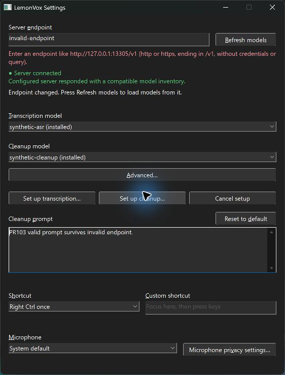
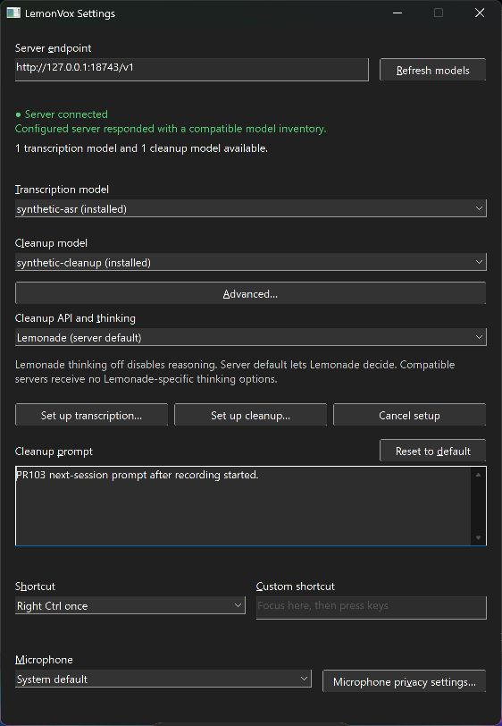
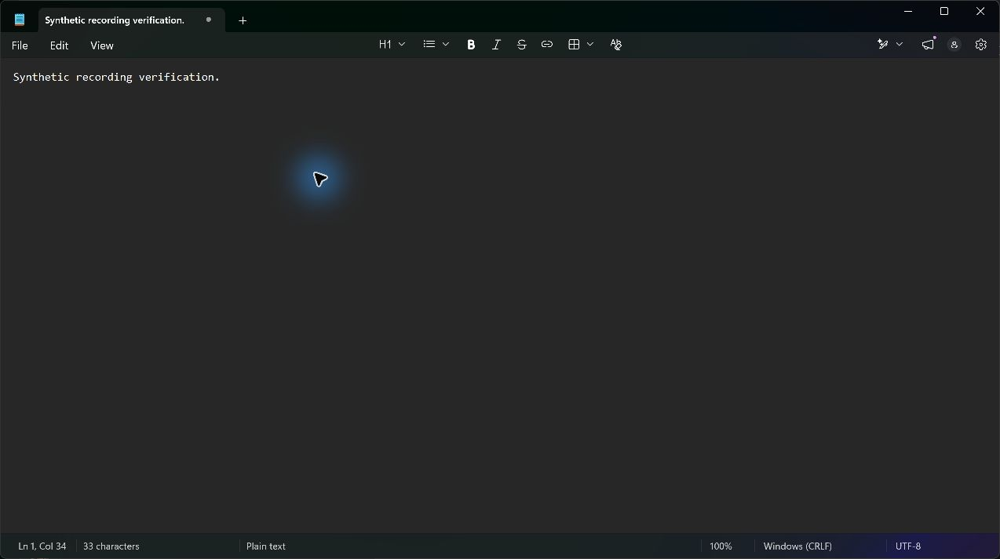

# PR 103 Windows machine verification — 2026-11-14

Candidate: `9ce8697e07b5a88207568bfebee3a4a4012a4554`, followed by the reset-prompt autosave fix and test correction accompanying this report. Screenshots and manual checks used the original candidate; the fix preserves its layout.

Environment: Windows 11 Enterprise, version `10.0.26300`, ARM64 host; MSVC `19.44` x64 Debug build using Visual Studio 2022 Build Tools, CMake and Ninja. Unlocked desktop, dark theme, configured display scale 200% (`LogPixels=192`). This is an x64 application on an ARM64 host, not an ARM64 build.

## Build and test

```powershell
powershell -ExecutionPolicy Bypass -File windows\scripts\build.ps1 -Output "$env:TEMP\lemonvox-pr103" -Configuration Debug -SkipTests
powershell -ExecutionPolicy Bypass -File windows\scripts\build.ps1 -Output "$env:TEMP\lemonvox-pr103" -Configuration Debug -Interactive
```

The first build completed all 106 steps. The first full run had 24 passing tests, one failed Settings test, and two CTest skips. The Settings failure was a stale assertion expecting capability wording that had been replaced by Advanced thinking guidance. The follow-up checks that guidance is hidden when Advanced is collapsed and visible/nonempty when expanded, retaining the existing behavior and persistence checks. The next run exposed a real reset-prompt autosave bug: `SetWindowTextW` on a multiline edit does not send `EN_CHANGE`, so Reset to default did not schedule saving. The reset handler now saves immediately, as a discrete action; the existing reset-persistence assertion is its regression check.

The fixed candidate passed a full rerun (25 CTest passes, zero failures, two explicit skips, 51.62 seconds). The PR then advanced concurrently to `351a94c5272a05d31c923003384f71f8c6872cd7`; this fix was rebased cleanly, rebuilt (55 steps) and the full suite rerun again. That final combined revision passed: 25 CTest passes, zero failures, two explicit skips, 86.81 seconds; `settings_interactive_test` passed in 4.24 seconds, and the native hook and insertion regressions passed. The real Lemonade endpoint at `127.0.0.1:13305` was unavailable: `pipeline_lemonade_test` and `app_e2e_test` report CTest skips, while `lemonade_net_test` returns success after printing its internal skip. Thus 24 tests performed their checks and passed; these three server-dependent cases are not real-server acceptance passes.

## Real application checks

Used an isolated `Software\LemonVoxTest\PR103Synthetic20261114` profile, a generated one-second silent PCM WAV through `--sample-wav`, and a loopback fixture on port 18743. The fixture advertised installed `synthetic-asr` and `synthetic-cleanup` models and returned fixed text. No microphone audio or model downloads were used.

- Selected both models, a custom cleanup prompt, Right Ctrl once, and Advanced Lemonade server-default mode. Read back the saved registry values and relaunched the application. Endpoint, models, prompt, shortcut and Advanced selection were retained; no Save/Cancel footer appeared.
- Entered `invalid-endpoint`: the actionable inline error appeared and the last valid saved endpoint remained intact. Edited a valid prompt independently and blurred it; the prompt saved while the endpoint draft stayed invalid. Restoring the valid endpoint recovered the form.
- One standalone right Ctrl tap began synthetic recording; a second finished it. Notepad received `Synthetic recording verification.` exactly once. The fixture logged one transcription POST and one cleanup POST, with no vendor thinking override in server-default mode.
- Began another synthetic recording, reopened Settings, changed the prompt and changed Advanced from Lemonade server-default to generic mode. The listening indicator remained active during editing. Finishing with right Ctrl inserted one additional result. The second cleanup request still contained the original prompt; registry readback contained the new prompt and generic backend, confirming the in-flight configuration snapshot was retained.
- Inspected expanded Advanced and inline endpoint errors at the current 200% scale. The screenshots below are captured native windows, not mockups. The recording indicator was captured as a separate transient window.

The portable protocol regression independently passed all three synthetic payload cases: Lemonade disabled includes `enable_thinking:false`; Lemonade server-default and generic omit it. The workflow, trigger core, preferences and controller regressions also passed independently.

## Screenshots










## Remaining acceptance evidence

Keep PR 103 and issues #96–98 open. This Windows session does not establish macOS or GNOME Wayland delivery. Ubuntu standalone modifiers remain incomplete. Remaining Windows coverage includes other modifier/side combinations, native pre-held/repeat/hold/focus edge cases beyond the existing hook regression, packaged install/relaunch, light theme and additional display scales, and real-server/live-microphone acceptance. Binding conflict and write-failure rollback were exercised by the interactive tests with their documented real-hook/fake-persistence boundaries, not by inducing a real application registry write failure. The in-flight manual check changed prompt/backend, not microphone hardware.
